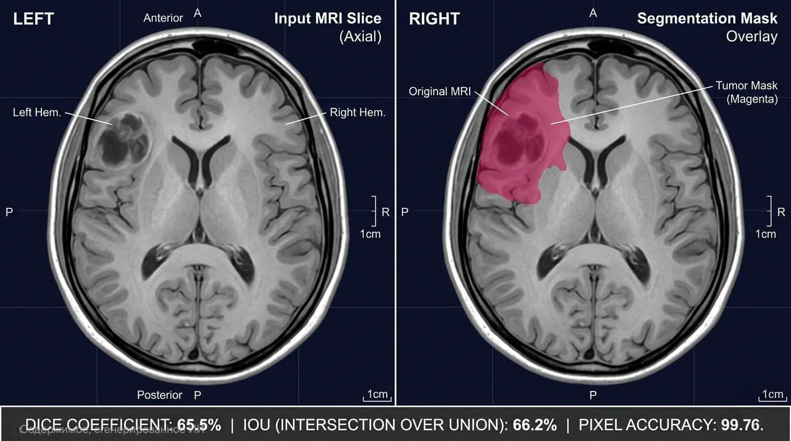

# brain-mri-segmentation

[](https://github.com/kiselyovd/brain-mri-segmentation/actions/workflows/ci.yml)
[](https://kiselyovd.github.io/brain-mri-segmentation/)
[](https://github.com/kiselyovd/brain-mri-segmentation/actions/workflows/ci.yml)
[](LICENSE)
[](https://www.python.org/)
[](https://huggingface.co/kiselyovd/brain-mri-segmentation)

<p align="center"></p>

Binary brain-tumor segmentation on MRI slices - fine-tuned **SegFormer-B2** as the main model and a hand-rolled **U-Net** as a reproducible baseline, both trained on the Mateusz Buda LGG (TCGA) dataset with a strict patient-level split to prevent data leakage.



> **Part of the [kiselyovd ML portfolio](https://github.com/kiselyovd#ml-portfolio)** - production-grade ML projects sharing one [cookiecutter template](https://github.com/kiselyovd/ml-project-template).

**Russian:** [README.ru.md](README.ru.md) · **Docs:** [kiselyovd.github.io/brain-mri-segmentation](https://kiselyovd.github.io/brain-mri-segmentation/) · **Model:** [kiselyovd/brain-mri-segmentation](https://huggingface.co/kiselyovd/brain-mri-segmentation)

## Dataset

Mateusz Buda's [LGG MRI Segmentation](https://www.kaggle.com/datasets/mateuszbuda/lgg-mri-segmentation) on Kaggle - 110 patients, 3,929 paired FLAIR slices with binary tumor masks from The Cancer Genome Atlas (TCGA). `src/brain_mri_segmentation/data/prepare.py` performs a **patient-level 80/10/10 split** (88/11/11 patients), so no patient appears in more than one partition.

Resulting slice counts: **3,133 train / 409 val / 387 test**.

## Results

**Legacy reported aggregates — metric-definition audit pending.** Stored values are retained for traceability, not as verified performance claims. The Dice/IoU definitions, checkpoint/config lineage and per-patient evaluation manifest need reconciliation before comparisons.

Historical values from the committed aggregate reports:

| Model | Dice | IoU | Pixel Accuracy |
|---|---|---|---|
| **SegFormer-B2** (main) | **65.5%** | **66.2%** | **99.7%** |
| U-Net 4-level baseline | 51.9% | 57.7% | 99.66% |

`reports/metrics.json` contains aggregate values, not per-slice or per-patient results.

## Visualizations

Selected tumor-bearing sample slices: input, dataset mask, and model prediction. The panel's source split is not recorded; these illustrations do not establish held-out performance:

<p align="center"></p>

Plot of the same legacy reported aggregates (metric-definition audit pending):

<p align="center"></p>

## Quick Start

```bash
# 1. Install
uv sync --all-groups

# 2. Sync Kaggle dataset into data/raw/ (once)
bash scripts/sync_data.sh /path/to/lgg-mri-segmentation

# 3. Build processed splits
uv run python -m brain_mri_segmentation.data.prepare --raw data/raw --out data/processed

# 4. Train (main model on GPU)
make train

# 5. Evaluate on test split
make evaluate

# 6. Serve the model locally
make serve
# or
docker compose up api
```

## Full Training Commands

**Main - SegFormer-B2:**

```bash
uv run python -m brain_mri_segmentation.training.train experiment=sota
```

**Baseline - U-Net (4 levels, 32→256 ch):**

```bash
uv run python -m brain_mri_segmentation.training.train \
  model=baseline \
  trainer.max_epochs=30 \
  trainer.output_dir=artifacts/baseline
```

Every run is tracked with MLflow under `./mlruns/`; launch `mlflow ui --backend-store-uri ./mlruns` to inspect.

## Inference

The Hub artifact is a Transformers-native SegFormer, not a Lightning `best.ckpt`. This example follows the repository preprocessing: RGB, [0, 1], tensor resize to 256×256 without ImageNet normalization. The published processor instead specifies 512×512 with normalization and is intentionally bypassed here. The returned mask corresponds to the resized input, not the original slice dimensions. This example does not validate the legacy metrics.

```python
import numpy as np
import torch
from PIL import Image
from torchvision.transforms import v2
from transformers import AutoModelForSemanticSegmentation

model = AutoModelForSemanticSegmentation.from_pretrained(
    "kiselyovd/brain-mri-segmentation",
    revision="0ea834ffd86dbca24666b34fa358387ec86f4bdf",
    use_safetensors=True, trust_remote_code=False,
).eval()
image = Image.open("slice.tif").convert("RGB")
pixels = torch.from_numpy(np.asarray(image, dtype=np.float32) / 255.0).permute(2, 0, 1)
pixels = v2.Resize((256, 256), antialias=True)(pixels).unsqueeze(0)
with torch.inference_mode():
    logits = model(pixel_values=pixels).logits
    logits = torch.nn.functional.interpolate(
        logits, size=(256, 256), mode="bilinear", align_corners=False
    )
    mask = logits.argmax(dim=1)[0]  # 256 x 256; 0 background, 1 tumor
```

A local `artifacts/checkpoints/best.ckpt` is produced by training and used by the repository's Lightning inference/serving path. It is not a file in the current Hub snapshot.

## Serving

```bash
docker compose up api
curl -X POST -F "file=@slice.tif" http://localhost:8000/segment
```

Endpoints:

| Method | Path | Purpose |
|---|---|---|
| `GET` | `/health` | Liveness probe |
| `POST` | `/segment` | Multipart TIFF/PNG → JSON mask |
| `GET` | `/metrics` | Prometheus metrics |

Every response carries an `X-Request-ID` header for log correlation.

## Project Structure

```
src/brain_mri_segmentation/
├── data/           # MRIDataModule, MRIDataset, prepare.py (patient-level split)
├── models/         # factory.py, lightning_module.py, unet.py
├── training/       # Hydra entrypoint
├── evaluation/     # Dice / IoU / pixel-accuracy report
├── inference/      # load_model + predict
├── serving/        # FastAPI app
└── utils/          # logging, seeding, HF Hub helpers
configs/            # Hydra configs (data / model / trainer / experiment)
data/
├── raw/            # original Kaggle download (images + masks per patient)
└── processed/      # train / val / test splits
docs/               # MkDocs site sources
tests/              # pytest suite
```

## Intended Use

Research and educational only. **Not a medical device.** Predictions must not be used for clinical decisions.

See [LIMITATIONS.md](docs/LIMITATIONS.md) for known failure modes and dataset-bias analysis.

## Citation

If this repo helps your work, please cite:

```bibtex
@software{kiselyov2026brainmri,
  author  = {Kiselyov, Daniil},
  title   = {brain-mri-segmentation: SegFormer-B2 brain tumor MRI segmentation},
  year    = {2026},
  url     = {https://github.com/kiselyovd/brain-mri-segmentation},
  version = {v0.1.0}
}
```

## License

MIT - see [LICENSE](LICENSE).
