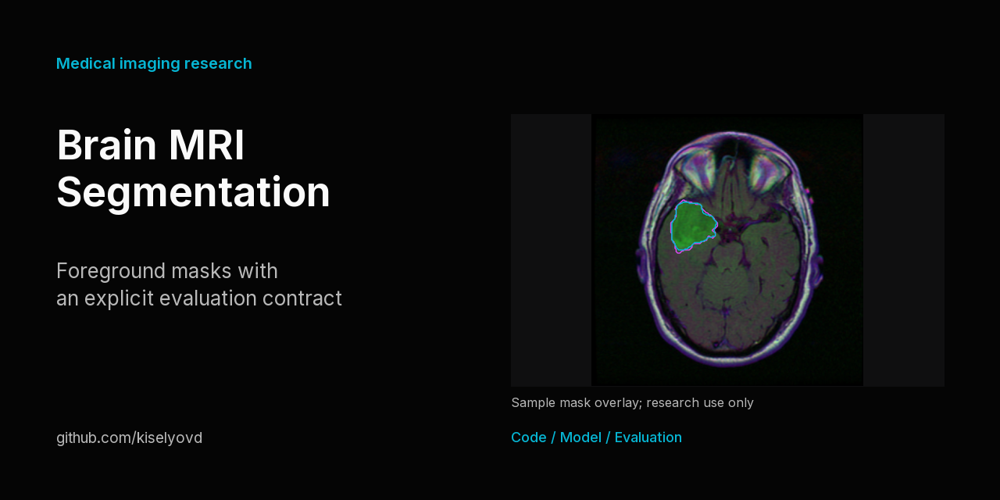

# Brain MRI segmentation

[](https://github.com/kiselyovd/brain-mri-segmentation/actions/workflows/ci.yml) · [Model & weights](https://huggingface.co/kiselyovd/brain-mri-segmentation) · [Evaluation contract](https://kiselyovd.github.io/brain-mri-segmentation/EVALUATION/) · [Русский](README.ru.md)

Segment FLAIR abnormalities in 2D LGG MRI slices with a fine-tuned SegFormer-B2. The repository includes the training pipeline, a small U-Net implementation, native safetensors weights and a replay with recorded model and data identities.

[](https://kiselyovd.github.io/brain-mri-segmentation/EVALUATION/)

<!-- ARTIFACT-OVERVIEW:START -->
Foreground Dice **88.08%** · Foreground IoU **78.70%**. [Evaluation and scope](https://github.com/kiselyovd/brain-mri-segmentation/blob/main/reports/replay-segformer-2026-10-15.json).

**Evidence:** Replayed on the reconstructed original patient split · 387 slices / 11 patients. Foreground scores pool confusion counts across all test pixels. Historical checkpoint training membership is unverified; this is not an independently established held-out benchmark or a replay of the missing U-Net baseline. Patient-macro Dice: see the full report.
<!-- ARTIFACT-OVERVIEW:END -->

## Evaluation

<!-- ARTIFACT-MANIFEST:START -->
### Current artifact and evaluation

**Replayed on the reconstructed original patient split · 387 slices / 11 patients**

| Metric | Value |
|---|---:|
| Foreground Dice | 88.08% |
| Foreground IoU | 78.70% |

Foreground scores pool confusion counts across all test pixels. Historical checkpoint training membership is unverified; this is not an independently established held-out benchmark or a replay of the missing U-Net baseline. Patient-macro Dice: see the full report.

[Evaluation record](https://github.com/kiselyovd/brain-mri-segmentation/blob/main/reports/replay-segformer-2026-10-15.json) · [Pinned model](https://huggingface.co/kiselyovd/brain-mri-segmentation/tree/48c79adfde8b063e74737357ab20a6f7f67a0b1b)
<!-- ARTIFACT-MANIFEST:END -->

The corrected foreground contract is explicit about class 1, pooled TP/FP/FN, empty masks and patient aggregation. The full report also provides patient-macro scores and patient-cluster bootstrap intervals across these 11 patients. These measures describe the reconstructed cohort, without establishing clinical validity or a main-versus-baseline advantage.

## Run the published model

```bash
uv sync --all-groups
```

```python
import numpy as np
import torch
from PIL import Image
from transformers import AutoImageProcessor, AutoModelForSemanticSegmentation

REPO = "kiselyovd/brain-mri-segmentation"
REVISION = "48c79adfde8b063e74737357ab20a6f7f67a0b1b"
processor = AutoImageProcessor.from_pretrained(
    REPO, revision=REVISION, backend="torchvision", trust_remote_code=False
)
model = AutoModelForSemanticSegmentation.from_pretrained(
    REPO, revision=REVISION, use_safetensors=True, trust_remote_code=False
).eval()
image = Image.open("slice.tif").convert("RGB")
# Float32 RGB in [0,255] avoids uint8 rounding during resizing.
inputs = processor(np.asarray(image, dtype=np.float32), return_tensors="pt")
with torch.inference_mode():
    logits = model(**inputs).logits
    logits = torch.nn.functional.interpolate(
        logits, size=(256, 256), mode="bilinear", align_corners=False
    )
    mask = logits.argmax(dim=1)[0]  # 0 background; 1 FLAIR abnormality
```

The corrected processor uses 256² inputs, rescaling 1/255 and no ImageNet normalization or label reduction. Numerical tests against the production tensor transform and actual predictions are recorded in [processor-parity.json](reports/provenance/processor-parity.json). The mask is at the resized input resolution. The Hub model is native Transformers format; local Lightning serving expects a separately trained `.ckpt`.

## Recover the original split and replay

Download the [original Mateusz Buda LGG MRI dataset](https://www.kaggle.com/datasets/mateuszbuda/lgg-mri-segmentation) and use one `kaggle_3m/` directory. The recorded archive contains duplicate copies of the same cohort; do not combine them.

```bash
uv run python -m brain_mri_segmentation.data.prepare \
  --raw /path/to/kaggle_3m --out data/processed
uv run python -m brain_mri_segmentation.evaluation.evaluate \
  --hf-model kiselyovd/brain-mri-segmentation \
  --revision 838da0dff1f96aa3b87d56d2099f2b86dec483bc \
  --weights-sha256 b8e0816e76ee1f849ad37b119fc42647beba5072e842db958b848b0673dedfa4 \
  --out reports/replay.json
```

The seed 42 patient split recovers 3133/409/387 slices and 88/11/11 patients exactly. [Source receipt](reports/provenance/lgg-source.json), [complete split manifest](reports/provenance/lgg-split-manifest.json) and [evaluation details](docs/EVALUATION.md) pin the source and file identities. Preparation rejects stale destinations. Evaluation checks image/mask hashes and saves prediction/target arrays, per-slice and per-patient counts, package versions and artifact hashes.

## Historical reports

<details>
<summary>Legacy aggregates and missing baseline checkpoint</summary>

The old evaluator fed integer masks to torchmetrics' default one-hot input contract. Its stored main Dice 65.5% / IoU 66.2% and baseline Dice 51.9% / IoU 57.7% remain in [the legacy records](docs/BENCHMARKS.md), without being promoted as verified quality claims. They were not swapped or relabeled as the new measures.

The original hand-rolled U-Net checkpoint is absent from the clone, public release and Hub. The dataset author's U-Net is a different model. No historical main-versus-baseline replay is claimed.

</details>

## Training and serving

[Training](docs/training.md) · [Serving](docs/serving.md) · [Reproducibility](docs/REPRODUCIBILITY.md) · [Limitations](docs/LIMITATIONS.md)

```bash
uv run python -m brain_mri_segmentation.training.train model=baseline \
  trainer.output_dir=artifacts/baseline
```

This creates a new run; it does not recover the missing historical baseline. Validation and evaluation now share the same foreground contract. Checkpoint selection uses validation loss.

## Scope, licenses and citation

The limited LGG/TCGA cohort, 2D input and reconstructed training lineage limit interpretation. Qualitative sample panels are illustrations; their original split was not recorded. This software does not provide clinical validation.

Original software is MIT. Dataset images/masks and source-derived manifests are CC-BY-NC-SA-4.0; the upstream SegFormer card uses `other` and links NVIDIA's research/evaluation license. These are separate components; see [licenses and attribution](docs/LICENSES.md) and [CITATION.cff](CITATION.cff).

## Contract automation

`artifact-manifest.json` is the source for the generated result block. CI checks report hashes, pinned artifacts and README drift; meaningful tests reject altered reports and unsupported held-out claims.

```bash
python scripts/artifact_manifest.py --check
python scripts/artifact_manifest.py --write
```
