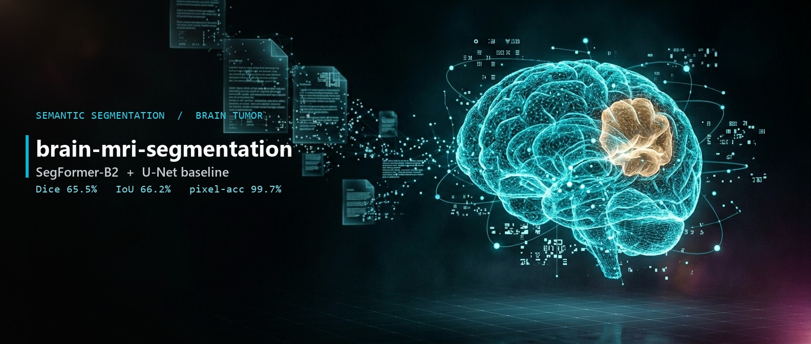
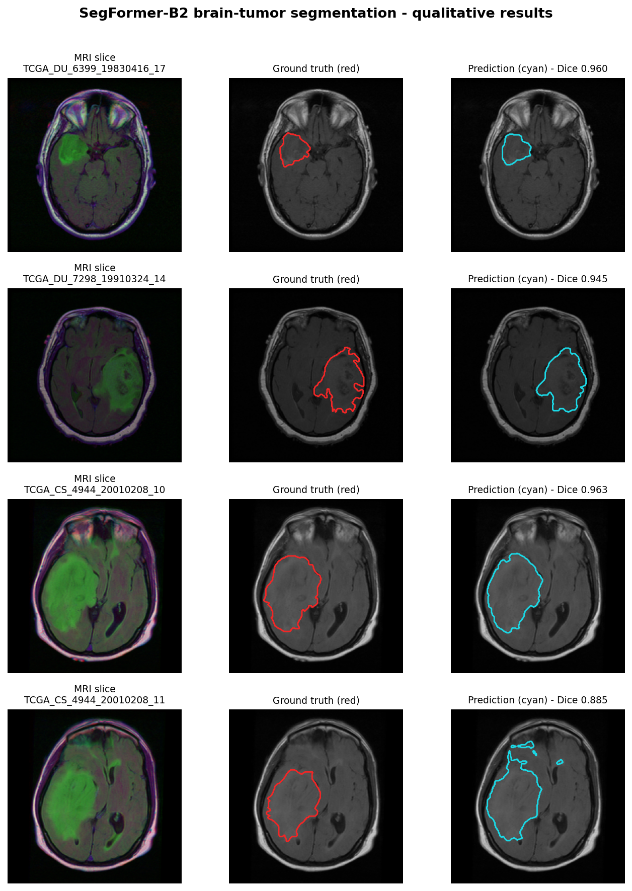
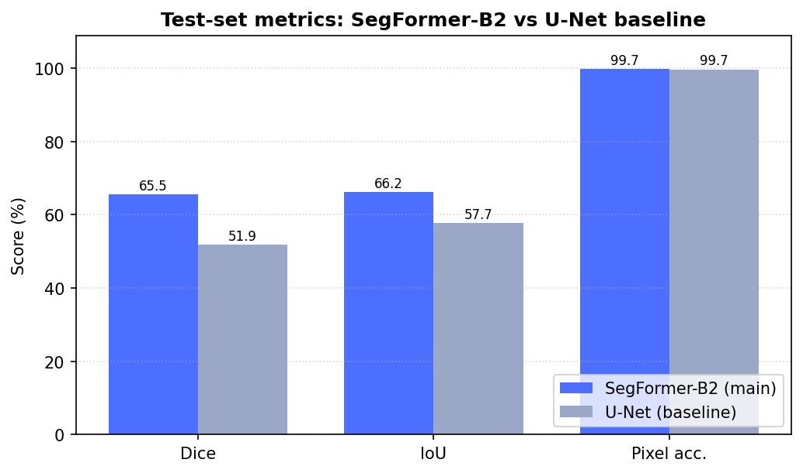

# brain-mri-segmentation

**Legacy reported aggregates — metric-definition audit pending.** Stored values are retained for traceability, not as verified performance claims. The Dice/IoU definitions, checkpoint/config lineage and per-patient evaluation manifest need reconciliation before comparisons.

Research pipeline for binary semantic segmentation of brain tumors from MRI scans - pixel-level mask prediction for low-grade glioma (LGG) regions.

Legacy SegFormer aggregates: Dice 65.5%, IoU 66.2%, pixel accuracy 99.73%; metric-definition audit pending.

## Overview

| | |
|---|---|
| **Task** | Binary semantic segmentation (tumor vs. background) |
| **Dataset** | [Mateusz Buda LGG MRI (TCGA)](https://www.kaggle.com/datasets/mateuszbuda/lgg-mri-segmentation) - 110 patients, 3 929 paired slices |
| **Main model** | SegFormer-B2 (`nvidia/segformer-b2-finetuned-ade-512-512`, ~25 M params) |
| **Baseline** | Small U-Net (4 levels, 32→256 ch, ~1.9 M params, hand-rolled) |
| **Stack** | PyTorch Lightning · Hydra · MLflow · DVC · FastAPI · Docker · GitHub Actions · MkDocs |
| **License** | MIT |

## Visualizations

Selected tumor-bearing samples: input, dataset mask and model prediction. The panel source split is not recorded; this is not held-out evaluation proof:

Plot of legacy aggregate records, with metric-definition audit pending:

## Sections

- [Architecture](architecture.md) - data flow, model choices, metrics rationale
- [Training](training.md) - running experiments, logging, overrides
- [Serving](serving.md) - FastAPI endpoints, Docker deployment
- [Benchmarks](BENCHMARKS.md) - legacy records and metric audit
- [Reproducibility](REPRODUCIBILITY.md) - pinned environment, one-command re-run
- [Limitations](LIMITATIONS.md) - failure modes, dataset bias
- [Model card](model_card.md.j2) - HF Hub card template

## Links

- **Code:** [GitHub](https://github.com/kiselyovd/brain-mri-segmentation)
- **Model:** [Hugging Face](https://huggingface.co/kiselyovd/brain-mri-segmentation)

## Disclaimer

Research/educational artifact only - **not** intended for clinical use.
